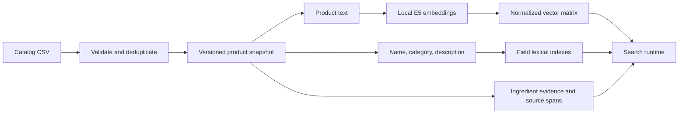
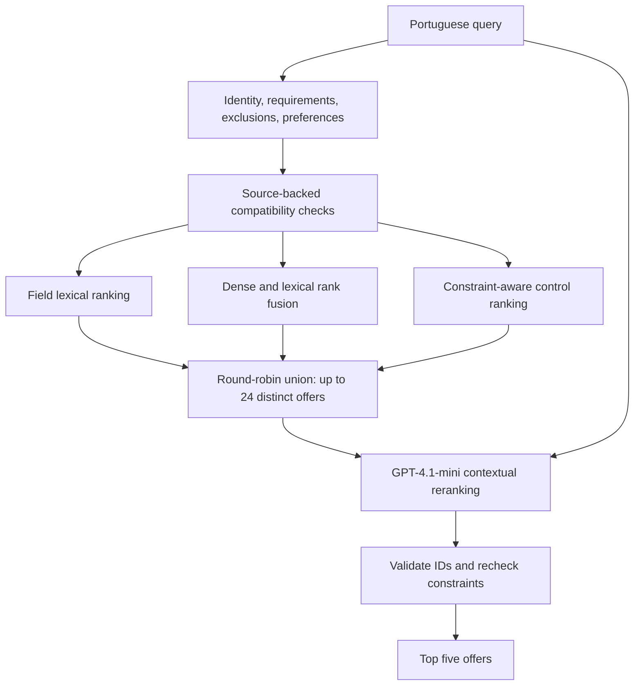

# Portuguese marketplace search

This project retrieves relevant catalog offers from natural-language Portuguese
queries. It combines local semantic embeddings, lexical matching, explicit
ingredient constraints and optional contextual reranking. The implementation
runs on one machine and exposes one entry point: `python scripts/main.py`.
Installation also provides `food-search`, which calls the same CLI implementation.

## Problem and data

The assignment supplies 100 queries and 5,000 catalog rows. Removing three
identical duplicate occurrences leaves **4,997 distinct offers from 1,806
merchants**. The catalog includes restaurant dishes, groceries, drinks and
household products; only 1,707 offers are classified as prepared foods.
Restricting retrieval to restaurant dishes would therefore lose valid results.

The data also limits what a search system can establish. There are 853 blank
descriptions, imperfect categories and 134 zero prices. Historical customizations
describe previous orders, not necessarily today's options. The implementation
preserves source provenance and treats missing product facts as unknown.

Two requirements drive the design:

1. Retrieve the right product even when the query and listing use different words.
2. Respect explicit exclusions without rejecting products merely because their
   ingredient list is incomplete.

For example, a burger containing cheddar contradicts “hambúrguer sem queijo”.
A burger whose listing never mentions cheese remains eligible. Optional cheese
does not establish default inclusion, and “sem cheddar” does not establish
absence of every cheese variety.

## Pipeline and system design

The offline stage validates the catalog, constructs product representations and
builds local indexes. It keeps vectors, lexical fields and ingredient evidence
separate because they answer different questions.



The contextual search path then separates candidate selection from final ordering:



### 1. Represent queries and products separately

Product text contains the name, selected type, category, description and declared
portions. It does not add inferred recipes or behavioral profile information.
The offline semantic baseline retains its fuller metadata representation; the
constraint-aware path uses a separate source-backed representation.

Query interpretation separates product identity, explicit requirements,
exclusions, preferences and ambiguity. A narrow local grammar handles supported
simple ingredient requests. Contextual mode uses GPT-4.1-mini for complex
uncached interpretations, with exact query spans attached to requirements.
The interpreter receives only the query. The original query remains available
for retrieval and reranking, rather than being replaced completely by a rewrite.

This distinction prevents an occasion such as “para compartilhar” from becoming
an invented numerical portion requirement. It also separates uncertain intent
from facts actually stated about a product.

### 2. Enforce explicit ingredient constraints

The matcher extracts recognized ingredient claims from names and descriptions,
retaining their field, quote, character offsets, polarity and component scope.
It distinguishes main ingredients, included sides, optional additions and
possible ingredient mentions.

Ingredient relationships are directional. Included cheddar supports the presence
of cheese; absence of cheddar does not prove absence of cheese. Included sides
count when evaluating exclusions. Historical customizations never establish
default ingredients or current availability.

Reliable contradictions are filtered **before candidate truncation**. Rankings
therefore draw replacement offers from deeper compatible positions, rather than
discarding a finished top five and leaving avoidable gaps. Unspecified ingredients
remain eligible; supported absence can help the control rank comparable offers.
The final contextual results are checked again against the same evidence.

This is a bounded source matcher, not a complete recipe or allergen knowledge
base. It cannot certify an unspecified product as cheese-free or allergy-safe.
If contextual mode finds fewer than five compatible offers, it reports an error
instead of padding with known contradictions. The fast control permits underfill.

### 3. Generate complementary candidates

The shortlist draws from three rankings:

- **Field lexical:** Portuguese-normalized, stemmed BM25 matching over name,
  category and description, with fixed weights **3/1/1**. Names receive more
  weight because they usually identify the offered product most directly.
- **Lean hybrid:** raw-query E5 similarity and field lexical ranking combined
  through reciprocal-rank fusion, using depth **100** and constant **60**.
- **Constraint-aware control:** original and positive-query dense retrieval,
  lexical matching and bounded identity/attribute compatibility adjustments.

The positive query omits excluded ingredient terms so that “sem queijo” does not
give ordinary positive lexical credit to cheese-heavy products. The evidence
matcher handles the exclusion itself.

Reciprocal-rank fusion sums `1 / (60 + rank)` across the lean hybrid's branches.
It combines their ordering without treating BM25 and cosine scores as calibrated
or interchangeable. The field weights and fusion settings are fixed engineering
choices, not claimed optima.

Round-robin selection merges the three lists, removes duplicate item IDs and
keeps up to 24 offers. This preserves candidates from different retrieval methods
instead of letting one heuristic choose every reranker input. The control still
contains hand-built compatibility signals; the experiments do not establish
that each individual signal is necessary.

### 4. Rank the shortlist in context

GPT-4.1-mini receives the original query, candidate names, categories, taxonomy
and declared description excerpts of at most 600 characters. Candidate order is
deterministically shuffled to reduce dependence on retrieval position. The model
does not receive retrieval scores, evaluation labels or behavioral profiles.

This stage addresses errors such as confusing a dish with its container,
retrieving an ingredient instead of a prepared meal, or letting one matching
adjective outweigh product identity. It must return five distinct IDs from the
provided set. The application validates those IDs and checks ingredient
compatibility before returning them.

The reranker cannot recover a missing candidate or a missing catalog fact, and
excerpts can omit relevant detail. Its scores **5 through 1 express ordering**,
not relevance probabilities.

## Why these choices?

### Local multilingual E5-small

The encoder is pinned `intfloat/multilingual-e5-small`, producing **384-dimensional**
vectors through ONNX Runtime on CPU. The implementation applies `query:` and
`passage:` prefixes, attention-mask mean pooling and L2 normalization. Exact dot
products then give cosine similarity.

E5-small provides semantic matching without per-query embedding API charges.
Local inference makes the embedding path independently runnable, and its compact
vectors suit this catalog. These operational advantages justify retaining it;
they do not prove it is the best Portuguese food encoder.

A prior E5-base comparison increased development pooled nDCG from .508 to .564,
but Success@5 remained 10/30 and the paired interval included harm. It did not
establish enough benefit to replace the incumbent. Earlier hosted embedding
comparisons were blocked by API access; there is no completed equivalent
comparison proving E5-small superior to OpenAI's embedding models.

### Hybrid retrieval and a bounded language-model stage

Embeddings handle paraphrases but do not reliably enforce logical negation.
Lexical matching helps exact dishes, brands and ingredients but misses indirect
requests. Combining their rankings preserves complementary matches.

Contextual reranking targets whole-query interpretation rather than adding more
individual ranking exceptions. GPT-4.1-mini was the inexpensive model evaluated
for this stage; limiting its input to 24 candidates bounds cost. No controlled
model sweep established that it outperforms every larger model or cross-encoder.
Its inclusion rests on the measured architecture comparison, with uncertainty
and latency kept explicit.

### Exact search, local state and omitted signals

With 4,997 offers, a normalized matrix and in-process lexical indexes are
proportionate. A distributed vector database or approximate index would add
deployment and recall trade-offs without a demonstrated need. SQLite persists
caches and cumulative API accounting on one host.

Images and behavioral profiles add cost or exposure bias without a demonstrated
incremental relevance gain here. They also cannot prove default ingredients or
current stock. Fine-tuning is deferred because the available labels are sparse
and model-generated; training could fit annotation artifacts instead of relevance.

## Evaluation and observed trade-offs

Prior experiments pooled results from competing methods and applied one judging
policy within each comparison. The architecture study used 30 development queries
and 390 judged query-product pairs. After freezing the methods, a separate model
authored 12 fresh synthetic queries without access to the catalog or old rankings.
GPT-4.1 judged their shared 152-pair pool, separately from the mini reranker;
independent checks assessed grader consistency.

| Method | Development nDCG@5 | Fresh nDCG@5 | Fresh Success@5 | Fresh mandatory conflicts |
| --- | ---: | ---: | ---: | ---: |
| Field lexical | .434 | .646 | 9/12 | 9/60 |
| Lean hybrid | .530 | .706 | 9/12 | 10/60 |
| Constraint-aware control | .654 | .774 | 10/12 | 2/60 |
| Contextual reranker | .787 | .799 | 11/12 | 4/60 |

**nDCG@5** measures ordering relative to the judged pool's ideal result, not
accuracy or full-catalog recall. **Success@5** counts queries with at least one
useful result, graded at least 2, in the first five. Mandatory conflicts can
concern identity or attributes as well as ingredients.

nDCG is defined for 29 development and 11 fresh queries. Compare methods within
each column: different pools and policies prevent interpreting the columns as
improvement over time. The fresh contextual advantage is only .024, with a paired
95% interval of **[-.095, +.165]**. MRR decreases slightly, and judged conflicts
increase. A disputed lactose judgment illustrates that source citations alone
do not validate a dietary inference.

These are automated estimates on a small synthetic set, not measured customer
utility. The fresh query-card policy was amended after a query-only pilot to
allow open discovery without inventing a mandatory product identity; rankings
did not change in response. The old final 70 queries were not reused as an
untouched tuning holdout. This source-only repository excludes historical
judgment sets and generated outputs; the table summarizes the earlier runs.

Local control top-100 generation measured **26.5 ms median** with cached plans
and query embeddings. First API ranking calls added **1.6 seconds median**, about
**$0.0016/query** over 30 requests. These are component measurements, not an
end-to-end production SLA. Contextual mode remains an explicit option because
the evidence does not justify a universal replacement.

## Run the application

Use Python **3.12+** and place the supplied `5k_items_curated.csv` and `queries.csv`
in the project root. The input files, credentials, models, caches and generated
outputs remain local and ignored by Git.

```powershell
python -m venv .venv
.\.venv\Scripts\Activate.ps1
python -m pip install -e .
python scripts/main.py setup
python scripts/main.py build
python scripts/main.py search "pizza de queijo" --json
```

On macOS/Linux activate with `source .venv/bin/activate`. Initial setup downloads
the pinned model assets, approximately 490 MB. `requirements-lock.txt` records
the tested Windows environment for an exact dependency installation.

For contextual search, put a normal OpenAI key in ignored `.env`:

```dotenv
OPENAI_NEW_KEY=your_key_here
```

```powershell
python scripts/main.py search "hamburguer sem queijo" --mode contextual --allow-api --json
python scripts/main.py batch --mode contextual --allow-api --output outputs/results.csv
python scripts/main.py serve --mode contextual --allow-api --port 8766
python scripts/main.py budget
```

The server binds to localhost and exposes `/health` and
`/search?q=hamburguer%20sem%20queijo&k=5`. Batch output contains query/item IDs,
ranks, scores, mode and release ID; it omits source descriptions. Existing output
files require `--overwrite` to replace explicitly.

| Mode | Purpose |
| --- | --- |
| `semantic-local` | Default offline semantic baseline. It does not enforce ingredient exclusions. |
| `lexical`, `hybrid-local` | Offline comparison methods. |
| `constraint-hybrid` | Fast constraint-aware control; simple or cached interpretations work offline. |
| `contextual` | Constraint-aware shortlist plus GPT-4.1-mini ordering; supports `k=1..5`. |

`--allow-api` is available only for contextual mode. Complex uncached requests
can require both interpretation and ranking calls. Valid results are cached by
their inputs and policy. Calls reserve against the persistent **$4.50 cumulative
ceiling** before transmission; missing credentials fail before reservation.
Provider failures are reported without hidden retries or service substitution.
The application uses `OPENAI_NEW_KEY` only at the official OpenAI endpoint.
Keep the existing ledger when reusing local state: changing its allocations is
rejected, and historical uncertain charges remain counted.
Development and validation accounted for **$2.623361**, including uncertain
reservations. The final uncached probe failed query-provenance validation.
Such validation failures stop the request;
the application does not silently repair the output or retry it.

## Source organization

```text
scripts/main.py                 # single command entry point
config.toml                     # data, model, retrieval and budget settings
pyproject.toml                   # package and pinned direct dependencies
requirements-lock.txt            # tested environment
src/prosus_search/
  cli.py                        # argument parsing and orchestration
  indexing.py, artifacts.py      # index construction and versioned snapshots
  catalog.py, representation.py  # validated input and baseline text
  local_embeddings.py            # pinned local model inference
  retrieval.py, grounded.py      # retrieval and constraint-aware control
  constraints.py, facets.py      # source evidence and compatibility
  understanding.py               # structured query interpretation
  quality.py, model_client.py    # contextual ordering and validated API calls
  runtime.py, store.py           # shared persistence, caches and accounting
  batch.py, server.py            # batch and HTTP interfaces
  eligibility.py, snapshots.py   # immutable context and snapshot validation
```

The cleaned application was checked against 135 core regressions, a real index
build and all 500 previously generated result IDs. Cache reuse does not establish
new model quality; it checks that restructuring preserved the existing rankings.

Production work should begin with live merchant/location/stock eligibility,
current option data and source freshness. Broader untouched query evaluation
should determine when reranking earns its latency. Add shared caches, replicas,
larger indexes or a distilled ranker only after measured traffic and catalog
bottlenecks justify them.
