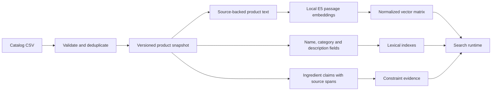
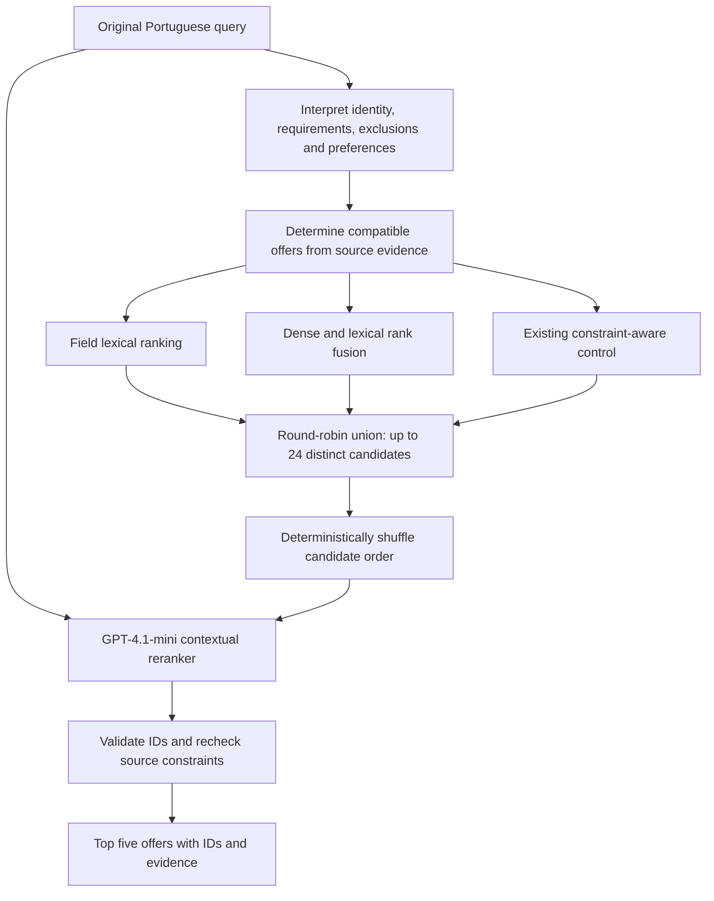

# Constraint-aware semantic search for a Portuguese marketplace

## Overview

This project matches natural-language Portuguese queries to offers in a mixed
food and retail catalog. The solution combines local semantic embeddings,
lexical retrieval, source-backed ingredient constraints and an optional language
model reranker. It returns five ranked offers for each of the 100 assignment
queries.

The main design decision is to separate **retrieving a plausible product** from
**checking whether it contradicts the request**. A burger can be semantically
close to “hambúrguer sem queijo” while explicitly containing cheddar. Conversely,
a burger whose description omits cheese is uncertain, not necessarily
incompatible. Similarity alone cannot make that distinction reliably.

The submitted predictions use the contextual reranking mode. A faster
constraint-aware control and the original offline embedding baseline remain
available for comparison and reproducibility. The experiments favor contextual
ranking on development queries, but the smaller fresh evaluation does not
establish a universal improvement.

**Deliverables:** [ranked results for all 100 queries](review/submission/contextual-top5.csv),
[five-slide presentation](review/submission/prosus-search-v4.pptx), and
[release and cost manifest](review/submission/manifest.json).

## 1. Understanding the data

The supplied CSV contains 5,000 rows, which reduce to **4,997 distinct offers**
after removing three redundant occurrences of an identical item ID. Distinct
offers from different merchants are retained, even when their text is similar.

| Observation | Consequence for the system |
| --- | --- |
| 1,806 merchants; only 1,707 offers belong to prepared foods | Preserve groceries, drinks and household products. Filtering the entire catalog to restaurant dishes would discard legitimate intents. |
| 853 descriptions are blank | A missing ingredient mention cannot be interpreted as evidence of absence. |
| Categories and taxonomy sometimes disagree with the offered product | Use them as retrieval context and ranking signals, not authoritative ingredient facts. |
| Profiles include historical customizations, co-purchases and search terms | Keep these separate from current product evidence. An old cheese customization does not establish either default inclusion or present availability. |
| Prices include 134 zeros | Do not interpret zero as a free product or use price as an unexplained relevance boost. |

The ingestion layer validates CSV/JSON structure, identifiers and numeric values,
retains source provenance, and rejects conflicting duplicate IDs. These choices
make results traceable to the supplied snapshot rather than silently repairing
ambiguous records. [Data audit](review/evidence/data-audit.json).

## 2. System design

The system has an offline preparation stage and a request-time search stage.
Product embeddings are built per catalog/model version; lexical indexes and
evidence are assembled from the same snapshot at runtime initialization.
Query interpretation and inference outputs are cached independently.



For the current representation, product text contains the name, selected type,
category, description and separately declared portions. The frozen baseline
retains its original, fuller metadata representation. Keeping the two versions
distinct prevents a representation change from silently altering old results.
Neither representation inserts guessed recipes or historical behavior into the
product description.

At request time, the contextual mode follows this pipeline:



This is a retrieve-then-rank architecture, with reliable constraint checks
applied **before** candidate cutoffs. It avoids spending the shortlist on known
contradictions and then trying to repair the final five with score penalties.

### 2.1 Query interpretation

The query is represented as product identity, explicit requirements, exclusions,
preferences and ambiguity. For example, “pizza sem queijo para compartilhar”
contains a product type, an ingredient exclusion and a sharing preference. It
does not specify an exact number of people.

A narrow local grammar handles supported simple ingredient queries. Other
queries use a cached, structured GPT-4.1-mini interpretation in contextual mode.
The interpreter receives only the query. Requirements retain exact query spans;
it receives no catalog candidates, evaluation cards or relevance labels.

Separating these fields matters because a preference such as an occasion should
not automatically become a mandatory product fact. The original query is also
retained for dense retrieval and reranking, so a mistaken canonical interpretation
does not completely replace what the user wrote.

### 2.2 Product evidence and ingredient constraints

Ingredient claims come from the product's name and description. Each recognized
claim records its source field, quoted text, offsets, polarity and component
scope. Scope distinguishes the main product, an included side, an optional
addition and a possible ingredient mention.

For “sem queijo”, the policy is:

| Product evidence | Treatment |
| --- | --- |
| Explicitly includes cheese or a recognized variety such as cheddar | Exclude. |
| Explicitly states absence of cheese | Retain and provide positive support. |
| Does not specify cheese | Retain as unknown. |
| Offers cheese as an optional addition | Do not infer default inclusion. |
| Says “sem cheddar” | Do not infer absence of all cheese varieties. |
| Includes a cheese-containing side | Treat the side as part of the offered product for an exclusion. |

Ingredient relationships are directional: cheddar implies cheese, while absence
of cheddar does not imply absence of cheese. Conflicting explicit claims remain
conflicts rather than becoming unspecified. Unsupported taxonomy assumptions
and historical customization records do not establish ingredient presence.

The constraint matcher deliberately uses a bounded vocabulary. It is useful for
auditable exclusions, not a complete recipe, allergen or dietary knowledge base.
It cannot certify that an unspecified product is cheese-free or safe for an
allergy. [Implementation](src/prosus_search/constraints.py).

### 2.3 Candidate generation

The contextual shortlist combines three complementary rankings:

1. **Field lexical retrieval:** Portuguese-normalized, stemmed tokens from name,
   category and description, with fixed BM25 field weights of 3/1/1. Names receive
   more weight because they usually identify the offered product more directly.
2. **Lean hybrid retrieval:** raw-query E5 similarity and field lexical ranking,
   combined through reciprocal-rank fusion over the top 100 compatible offers.
3. **The constraint-aware control:** original and positive-query dense retrieval,
   lexical retrieval and bounded identity/attribute compatibility adjustments.

The positive retrieval query omits excluded ingredient names. Otherwise “sem
queijo” could give ordinary positive lexical credit to cheese-heavy products.
The exclusion itself is enforced through the separate evidence check.

For the lean hybrid, reciprocal-rank fusion sums `1 / (60 + rank)` across its
branches. Rank fusion avoids pretending that a BM25 score and a cosine score
share a calibrated numerical scale. Depth 100, constant 60 and the field weights
are fixed experiment settings, not proven optimal hyperparameters.

Candidates are taken round-robin from the three lists, deduplicated by item ID,
and capped at 24. This preserves alternatives from different retrieval methods
instead of asking one ranking heuristic to choose every reranker input. The
control still contains hand-built compatibility signals; the design does not
claim those signals have been individually validated or eliminated.

All three rankings operate over compatible offers before their cutoff. This
provides replacement candidates from deeper ranks when explicit contradictions
are removed. A final source check guards the returned IDs. If fewer than five
compatible offers exist, contextual mode reports an error rather than padding
with incompatible products; the fast control supports underfilled results.

### 2.4 Contextual reranking

GPT-4.1-mini sees the original query and candidate names, categories, taxonomy and
description excerpts of at most 600 characters. Candidate order is shuffled
deterministically to reduce dependence on retrieval position. Retrieval scores,
evaluation labels and behavioral profiles are excluded from the prompt.

The reranker addresses errors that individual token or embedding matches handle
poorly: confusing a food with its container, choosing an ingredient instead of a
prepared dish, or allowing one matching adjective to override product identity.
It must return five distinct IDs from the supplied candidate set. The application
validates that contract and rechecks the bounded source constraints.

This stage cannot recover a relevant offer missing from its shortlist, and an
excerpt can omit useful detail. It also adds API latency and can make semantic
mistakes. Its output scores are ordinal values 5 through 1, not estimated
relevance probabilities. [Serving implementation](src/prosus_search/quality.py).

## 3. Why these models and methods?

### E5-small instead of immediately buying a larger embedding model

The retained encoder is pinned `intfloat/multilingual-e5-small`, producing
384-dimensional vectors through local ONNX Runtime inference. Queries and
products use the appropriate `query:` and `passage:` prefixes. Token embeddings
are attention-mask mean-pooled and L2-normalized; retrieval uses exact dot
products, equivalent to cosine similarity for these normalized vectors.

E5-small provides a practical semantic baseline without per-query embedding API
charges. Local inference also makes the embedding path independently runnable.
Its compact vectors and the small catalog make exhaustive search straightforward.
These are operational reasons to retain it, not proof that it is the strongest
Portuguese food encoder.

The larger-model evidence is mixed. A completed E5-base comparison increased
development pooled nDCG from .508 to .564, but Success@5 stayed at 10/30 and the
paired difference interval included harm. That did not establish enough benefit
to replace the incumbent. A larger INT8 encoder experiment was specified, but it
does not supply a completed judged superiority result for this submission.
[E5-base comparison](review/E5-BASE-DECISION-v2.md).

OpenAI's small and large embedding models are supported in the experimental
code. Earlier hosted comparisons were blocked by API access; there is no
completed equivalent comparison here establishing that local E5 beats them.
Choosing E5-small therefore avoids making the submission depend on an unfinished
comparison. A future encoder replacement should demonstrate better candidate
coverage on new queries under the same representation and evaluation policy.

### Hybrid retrieval instead of embeddings alone or keywords alone

Embeddings help with paraphrases but do not reliably enforce logical negation.
Lexical matching is useful for brands, named dishes and exact ingredients but
can miss indirect requests. Combining their rankings preserves complementary
matches. The lexical-only experiment was substantially weaker on the evaluated
indirect queries, so it remains a candidate source rather than the final method.

The lean hybrid also lost to the existing control. This cautions against removing
all query and attribute handling in the name of simplicity. However, that
experiment changed several components together; it cannot prove that every
existing compatibility rule is necessary.

### A small contextual reranker instead of more ranking rules

The observed errors often concerned the relationship between the complete query
and product identity, rather than an absent synonym. A bounded language-model
reranker can read those relationships directly, while candidate retrieval and
source verification constrain its role.

GPT-4.1-mini was the inexpensive model tested for this stage. Restricting it to
24 candidates limits prompt size and cost compared with reading the whole
catalog. There was no controlled model-family sweep proving mini superior to
nano, GPT-4.1 or a dedicated cross-encoder. Its inclusion is justified by the
measured architecture comparison, with the trade-offs below kept explicit.

### Exact search and SQLite instead of a distributed search stack

At 4,997 offers, a normalized vector matrix and in-process lexical indexes are
sufficient for this prototype. An approximate nearest-neighbor service would
introduce deployment and recall trade-offs without a demonstrated need. SQLite
provides persistent caching and API accounting on one host. These choices make
the assignment easier to reproduce; they are not a claim that this deployment
architecture is sufficient for portfolio-scale traffic.

Images, co-purchases and historical search terms are omitted because no
incremental retrieval benefit was demonstrated. Behavioral fields can reinforce
past exposure, while images cannot establish hidden ingredients. Fine-tuning is
also deferred: the current sparse, model-generated labels could teach annotation
artifacts as readily as better relevance.

## 4. Evaluation without predefined ground truth

The evaluation pools top-five candidates from competing systems and judges them
under a shared rubric. Grades distinguish irrelevant, partial, useful and strong
matches, with explicit treatment of product identity, requirements and missing
evidence. All reported relevance labels are model judgments.

The architecture comparison uses 30 development queries and a shared 390-pair
pool. Compatible historical labels are preserved; new candidates receive new
judgments. After the methods were frozen, a separate model authored 12 fresh
synthetic queries without seeing the catalog, previous queries or rankings.
Their shared pool contains 152 query-product pairs, judged primarily by GPT-4.1,
separate from the GPT-4.1-mini reranker. Independent checks assess grader
consistency. [Protocol and detailed evidence](review/REASSESSMENT.md).

The metrics answer different questions:

- **nDCG@5:** how well the five results are ordered relative to the judged pool's
  ideal ranking. It is not accuracy or a full-catalog relevance measure.
- **Success@5:** the fraction of queries with at least one useful result
  (grade at least 2) among the first five.
- **MRR@5:** how early the first useful result appears.
- **Mandatory contradictions:** model-judged result positions conflicting with
  mandatory requirements, which can concern identity or attributes, not only ingredients.
- **Returned coverage:** whether five results were produced; this does not imply
  five relevant products or establish catalog recall.

### Results

| Method | Development nDCG@5 | Fresh nDCG@5 | Fresh Success@5 | Fresh mandatory conflicts |
| --- | ---: | ---: | ---: | ---: |
| Field lexical | .434 | .646 | 9/12 | 9/60 |
| Lean hybrid | .530 | .706 | 9/12 | 10/60 |
| Constraint-aware control | .654 | .774 | 10/12 | 2/60 |
| Contextual reranker | **.787** | **.799** | **11/12** | 4/60 |

nDCG is defined for 29 development queries and 11 fresh queries; queries with
zero pooled ideal gain remain in Success and MRR. Compare methods within a
column. The two datasets have different pools and evaluation policies, so the
columns do not describe improvement over time.

Contextual ranking improves the development point estimate, primarily through
better product selection. On the fresh set, its nDCG advantage is only .024,
with a paired 95% interval of **[-.095, +.165]**. Fresh MRR is slightly lower
(.819 versus .833), and mandatory conflicts increase. One disputed exclusion
judgment infers lactose status from condensed milk rather than an explicit
lactose statement; the original label is retained and the uncertainty disclosed.

Consequently, the contextual method is submitted as an explicit quality option,
while the default remains unchanged. It is not a demonstrated universal winner.
The fresh set is small and synthetic; agreement between graders is not customer
utility. The fresh query-card policy was also amended after a query-only pilot
to allow open-ended discovery without an invented mandatory product identity.
The amendment is versioned, and rankings did not change in response.

The old final 70 queries were already evaluated and were not reused as an
untouched holdout for tuning this architecture. Exporting predictions for all
100 assignment queries is separate from making a new held-out quality claim.

## 5. Runtime, reliability and production limits

| Measurement | Observed result | Scope |
| --- | --- | --- |
| Local control top-100 generation | 26.5 ms median | Cached interpretations and query embeddings; not full contextual latency. |
| First API reranking request | 1.6 s median; about 2.0 s p95 | 30 development requests, including validation and ledger settlement; additional to candidate generation. |
| Reranking cost | About $0.0016/query | Confirmed ranking calls; uncached query interpretation can add cost. |
| Cumulative API accounting | $2.623069 against a $4.50 ceiling | Includes prior experiments, failed/invalid calls and conservative uncertain reservations. |

These measurements do not establish production throughput, an end-to-end SLA or
a conversion uplift. In particular, cached embedding lookup and fresh embedding
inference are different workloads.

Model assets, source snapshots, representations and releases are fingerprinted.
Embedding caches include model/representation identity; reranking caches include
the actual candidate packet and prompt contract. Cached experiment rankings were
imported only after verifying exact serving inputs. The application reproduced
all 42 measured contextual rankings and matched all 500 submitted result IDs
through actual HTTP requests.

Remote calls require explicit `--allow-api` and reserve against the persistent
cumulative ledger before transmission. Contextual mode uses `OPENAI_NEW_KEY`
only at the official OpenAI endpoint. Credentials are excluded from version
control and logs. Failed calls produce explicit errors; the application does
not silently switch providers or ranking methods. The localhost service reuses
loaded indexes and applies admission control rather than permitting unbounded
concurrent inference.

Before production, the most valuable additions are live merchant/location/stock
eligibility, current option data and source freshness. Broader untouched query
evaluation should then determine when reranking earns its latency and cost.
Shared accounting, service replication, larger indexes or a distilled reranker
should follow measured traffic and catalog bottlenecks. No such scale benefit is
claimed from this local prototype.

## 6. Running and reproducing the submission

Use Python 3.12+ and place the supplied `5k_items_curated.csv` and `queries.csv`
in the repository root. Raw inputs, model weights, local caches and credentials
are intentionally untracked.

```powershell
python -m venv .venv
.\.venv\Scripts\Activate.ps1
python -m pip install -r requirements-lock.txt
python -m pip install --no-deps -e .
python -m prosus_search setup --local-model
python -m prosus_search build --backend local
python -m prosus_search search "pizza de queijo" --mode semantic-local --json
```

The lock file records the tested Windows environment. On macOS/Linux activate
with `source .venv/bin/activate`; `pip install -e '.[local,dev]'` is the alternative
dependency installation. Initial model setup downloads approximately 490 MB.
The fresh artifact rebuild was verified using existing assets and caches, not
an entirely fresh network installation.

For the submitted contextual mode, set a normal OpenAI key as `OPENAI_NEW_KEY`
in ignored root `.env`, then run:

```powershell
python -m prosus_search search "hamburguer sem queijo" --mode contextual --allow-api --json
python -m prosus_search serve --mode contextual --port 8766 --allow-api
```

The service binds to localhost and exposes `/health` and
`/search?q=hamburguer%20sem%20queijo&k=5`. Contextual mode supports `k=1..5`.
The `constraint-hybrid` mode is the fast control; `semantic-local` is the frozen
offline default and does not guarantee ingredient filtering. Simple or cached
constraint queries can work offline; uncached complex interpretation requires
the appropriate explicit API route. [Operational details](review/SUBMISSION.md).

Replay the saved comparisons and verify the submission without paid judging:

```powershell
python scripts/reassessment_lab.py replay
python scripts/reassessment_open_intent.py --replay
python scripts/verify_submission.py
python -m prosus_search budget
```

To intentionally regenerate all predictions after setup, use
`python scripts/prepare_quality_submission.py --export --allow-api`. This can
make paid calls and replace export receipts; preserve the submitted files first.
Fresh model outputs need not be byte-identical to the committed predictions.

The last full tracked test run passed **513 tests**. Verification also covers
ID/schema validation, ingredient hierarchy, negation, optional additions,
included sides, unspecified-product retention, budget behavior, cached parity
and actual uncached API requests. [Verification receipts](review/SUBMISSION.md#what-is-verified).

### Code organization

| Module | Responsibility |
| --- | --- |
| [`catalog.py`](src/prosus_search/catalog.py), [`representation.py`](src/prosus_search/representation.py) | Validated ingestion, provenance and the frozen baseline text representation. |
| [`local_embeddings.py`](src/prosus_search/local_embeddings.py), [`retrieval.py`](src/prosus_search/retrieval.py) | Pinned E5 inference, lexical indexes, exact scoring and stable ranking. |
| [`grounded.py`](src/prosus_search/grounded.py), [`understanding.py`](src/prosus_search/understanding.py) | Source-backed product representation and query interpretation. |
| [`constraints.py`](src/prosus_search/constraints.py), [`facets.py`](src/prosus_search/facets.py) | Ingredient evidence, relationships, component scope and compatibility signals. |
| [`quality.py`](src/prosus_search/quality.py) | Candidate union, official API routing, contextual reranking and final verification. |
| [`store.py`](src/prosus_search/store.py), [`artifacts.py`](src/prosus_search/artifacts.py) | Persistent caches, budget accounting and versioned artifacts. |
| [`cli.py`](src/prosus_search/cli.py), [`server.py`](src/prosus_search/server.py) | Command-line and localhost interfaces. |

`review/submission/` contains the selected deliverables. Other reports and
evaluation artifacts under `review/`, `protocols/` and `results/` preserve the
experimental history; their older costs, policies and defaults are snapshots,
not additional current submission claims.
